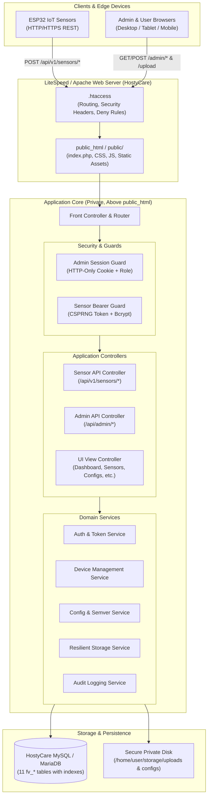

# Application Architecture Specification

## 1. High-Level Architectural Diagram



---

## 2. Directory Structure & HostyCare Document Root Mapping

To ensure absolute security on shared cPanel hosting, application code and storage are placed **above `public_html`**, preventing any direct URL access to private source files, database credentials, or uploaded binary files.

```
/home/username/                        <-- cPanel Home Directory
├── app/                               <-- PRIVATE Application Core (Zero Web Access)
│   ├── config/
│   │   ├── app.php                    <-- Core configuration
│   │   └── database.php               <-- PDO connection factory
│   ├── database/
│   │   ├── schema.sql                 <-- MySQL / MariaDB Schema DDL
│   │   └── seed.sql                   <-- Development test dataset
│   ├── src/
│   │   ├── Controllers/
│   │   │   ├── AdminApiController.php
│   │   │   ├── SensorApiController.php
│   │   │   ├── AdminViewController.php
│   │   │   └── PublicViewController.php
│   │   ├── Middleware/
│   │   │   ├── AdminSessionGuard.php
│   │   │   └── SensorTokenGuard.php
│   │   ├── Services/
│   │   │   ├── AuthService.php
│   │   │   ├── DeviceService.php
│   │   │   ├── ConfigService.php
│   │   │   ├── StorageService.php
│   │   │   └── AuditService.php
│   │   └── Utils/
│   │       ├── Semver.php
│   │       ├── DeviceIdValidator.php
│   │       ├── View.php
│   │       └── Response.php
│   ├── views/                         <-- UI View Templates (HTML5 + Tailwind tokens)
│   │   ├── layouts/
│   │   │   ├── admin.php              <-- Admin Shell (Sidebar, Header, Drawer)
│   │   │   └── public.php             <-- Public Upload Shell
│   │   ├── admin/
│   │   │   ├── dashboard.php
│   │   │   ├── sensors.php
│   │   │   ├── sensor-detail.php
│   │   │   ├── configs.php
│   │   │   ├── history.php
│   │   │   ├── files.php
│   │   │   ├── metrics.php
│   │   │   ├── audit.php
│   │   │   └── login.php
│   │   └── public/
│   │       └── upload.php
│   ├── storage/                       <-- PRIVATE Storage
│   │   ├── uploads/                   <-- Uploaded sensor files
│   │   ├── configs/                   <-- Global configuration files
│   │   └── logs/                      <-- Application error logs
│   └── .env                           <-- Secrets & DB credentials (chmod 600)
│
└── public_html/                       <-- PUBLIC Document Root
    ├── index.php                      <-- Front controller bootstrap
    ├── .htaccess                      <-- URL rewrite rules & security headers
    └── assets/
        ├── css/
        │   └── styles.css             <-- Full Tailwind Design Tokens & Utilities
        └── js/
            ├── app.js                 <-- Client interactions & 30s auto-refresh
            └── lucide.min.js          <-- Vector icon library
```

---

## 3. Database Entity-Relationship (ER) Model

```mermaid
erDiagram
    fv_admin_accounts ||--o{ fv_device_registration_requests : "reviews"
    fv_admin_accounts ||--o{ fv_global_sensor_configurations : "uploads/activates"
    fv_admin_accounts ||--o{ fv_device_status_events : "transitions"
    fv_admin_accounts ||--o{ fv_admin_audit_events : "performs"
    
    fv_registered_devices ||--o{ fv_uploaded_file_records : "uploads"
    fv_registered_devices ||--o{ fv_sensor_config_download_events : "downloads"
    fv_registered_devices ||--o{ fv_sensor_version_check_events : "checks"
    fv_registered_devices ||--o{ fv_daily_sensor_version_check_metrics : "aggregates"
    fv_registered_devices ||--o{ fv_device_status_events : "history"

    fv_admin_accounts {
        VARCHAR(36) id PK
        VARCHAR(100) username UK
        VARCHAR(255) password_hash
        ENUM role "ADMIN, SUPER_ADMIN"
        TINYINT is_active
        DATETIME created_at
        DATETIME updated_at
        DATETIME last_login_at
    }

    fv_registered_devices {
        VARCHAR(36) id PK
        VARCHAR(100) device_id UK
        ENUM status "ACTIVE, DEACTIVE"
        DATETIME registered_at
        VARCHAR(255) token_hash
        DATETIME first_seen_at
        DATETIME last_seen_at
        VARCHAR(50) sensor_version
        VARCHAR(50) firmware_version
        VARCHAR(100) hardware_model
        JSON metadata
        INT upload_count
        BIGINT total_storage_bytes
        DATETIME last_upload_at
    }

    fv_device_registration_requests {
        VARCHAR(36) id PK
        VARCHAR(100) device_id
        ENUM status "PENDING, APPROVED, REJECTED, CANCELLED, AUTO_APPROVED"
        DATETIME submitted_at
        DATETIME reviewed_at
        TEXT review_reason
        VARCHAR(36) reviewed_by_admin_id FK
        JSON requester_metadata
        VARCHAR(100) pending_device_key UK
    }

    fv_uploaded_file_records {
        VARCHAR(36) id PK
        VARCHAR(64) upload_record_id UK
        BIGINT sequence_number
        VARCHAR(36) registered_device_id FK
        VARCHAR(100) device_id
        VARCHAR(255) original_file_name
        VARCHAR(500) storage_key
        VARCHAR(100) mime_type
        VARCHAR(20) file_extension
        BIGINT file_size_bytes
        VARCHAR(64) checksum
        ENUM upload_status "PENDING, STORED, FAILED"
        DATETIME uploaded_at
    }

    fv_global_sensor_configurations {
        VARCHAR(36) id PK
        VARCHAR(50) config_version UK
        ENUM status "INACTIVE, ACTIVE, ARCHIVED"
        VARCHAR(255) original_file_name
        VARCHAR(500) storage_key
        VARCHAR(100) mime_type
        BIGINT file_size_bytes
        VARCHAR(64) checksum
        VARCHAR(36) uploaded_by_admin_id FK
        VARCHAR(36) activated_by_admin_id FK
        DATETIME activated_at
        DATETIME created_at
    }

    fv_sensor_config_download_events {
        VARCHAR(36) id PK
        VARCHAR(36) config_id FK
        VARCHAR(100) device_id
        VARCHAR(50) config_version
        VARCHAR(45) ip_address
        DATETIME downloaded_at
    }

    fv_sensor_version_check_events {
        VARCHAR(36) id PK
        VARCHAR(100) device_id
        VARCHAR(50) reported_version
        VARCHAR(50) active_version
        ENUM result "CURRENT, UPDATE_AVAILABLE, SENSOR_DEACTIVATED, NO_CONFIGURATION_AVAILABLE, INVALID_VERSION, SENSOR_NOT_REGISTERED"
        DATETIME checked_at
    }

    fv_daily_sensor_version_check_metrics {
        VARCHAR(36) id PK
        VARCHAR(100) device_id
        DATE metric_date
        VARCHAR(50) result
        INT check_count
    }

    fv_device_status_events {
        VARCHAR(36) id PK
        VARCHAR(100) device_id
        ENUM previous_status "ACTIVE, DEACTIVE"
        ENUM new_status "ACTIVE, DEACTIVE"
        VARCHAR(36) changed_by_admin_id FK
        TEXT reason
        DATETIME changed_at
    }

    fv_admin_audit_events {
        VARCHAR(36) id PK
        VARCHAR(36) admin_id
        VARCHAR(100) username
        VARCHAR(100) action
        VARCHAR(100) entity_type
        VARCHAR(100) entity_id
        JSON metadata
        VARCHAR(45) ip_address
        VARCHAR(255) user_agent
        DATETIME created_at
    }

    fv_storage_blobs {
        VARCHAR(500) storage_key PK
        LONGBLOB data
        BIGINT byte_size
        DATETIME created_at
    }
```



---

## 4. API Endpoints Contract

### Sensor API (`/api/v1/sensors/*`)
| Method | Route | Auth | Description |
|---|---|---|---|
| `POST` | `/api/v1/sensors/register` | None | Device self-registration request |
| `POST` | `/api/v1/sensors/heartbeat` | Bearer Token / X-Sensor-Id | 30s heartbeat keepalive |
| `POST` | `/api/v1/sensors/version-check` | Bearer Token | Semver version check against active configuration |
| `GET` | `/api/v1/sensors/configuration/download` | Bearer Token | Binary stream download of active configuration |
| `POST` | `/api/v1/sensors/upload` | Bearer Token | Multipart file upload with SHA-256 verification |

### Admin API (`/api/admin/*`)
| Method | Route | Auth | Description |
|---|---|---|---|
| `POST` | `/api/admin/login` | None | Admin authentication with HTTP-only cookie |
| `POST` | `/api/admin/logout` | Session | Invalidate session and clear cookie |
| `GET` | `/api/admin/session` | Session | Get current authenticated admin info |
| `GET` | `/api/admin/sensors/stats` | Session | Aggregated counts for 9 dashboard stat cards |
| `GET` | `/api/admin/sensors` | Session | Filterable, paginated device list |
| `GET` | `/api/admin/sensors/{id}` | Session | Single device details with upload history |
| `PATCH`| `/api/admin/sensors/{id}/status` | Session | Toggle status between `ACTIVE` and `DEACTIVE` |
| `POST` | `/api/admin/sensors/{id}/token` | Session | Generate new CSPRNG token (returns raw token once) |
| `GET` | `/api/admin/configuration` | Session | List all configurations |
| `POST` | `/api/admin/configuration` | Session | Upload new global configuration file |
| `POST` | `/api/admin/configuration/{id}/activate` | Session | Atomically activate config with semver validation |
| `GET` | `/api/admin/files` | Session | Paginated uploaded file records |
| `GET` | `/api/admin/files/{id}/download` | Session | Secure download of uploaded file |
| `DELETE`| `/api/admin/files/{id}` | Session | Delete uploaded file record and storage file |
| `GET` | `/api/admin/history` | Session | Registration requests list |
| `POST` | `/api/admin/history/{id}/approve` | Session | Approve request and generate initial bearer token |
| `POST` | `/api/admin/history/{id}/reject` | Session | Reject request with reason note |
| `GET` | `/api/admin/version-check-metrics` | Session | Aggregated version check telemetry |
| `GET` | `/api/admin/audit` | Session | Chronological admin audit trail |
